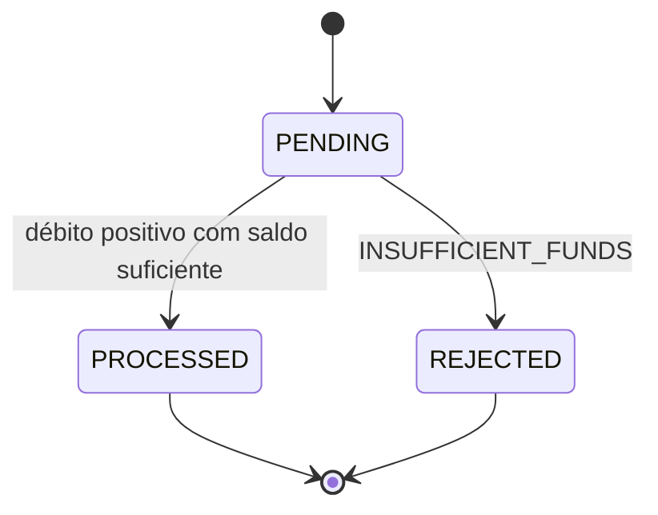
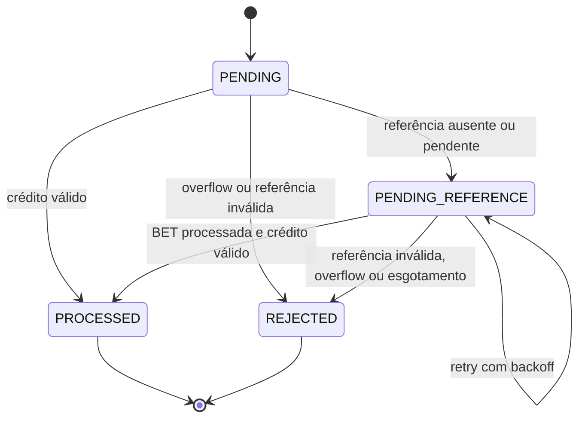

# Decisões de arquitetura

## Money

`internal/domain/money` representa dinheiro como `int64` em centavos e moeda
encapsulados. Todos os cálculos e conversões usam inteiros e strings. As operações
devolvem novos valores, preservando os operandos.

### Entrada e normalização

- As moedas suportadas são `BRL` e `USD`, códigos ISO 4217 com escala de duas casas.
- `New` recebe uma string não negativa: parte inteira não vazia, ponto e exatamente
  duas casas decimais, usando apenas dígitos ASCII. Zero é permitido neste tipo;
  as restrições de cada operação financeira serão aplicadas pelo domínio correspondente.
- Sinais, espaços, vírgula, notação científica, `NaN`, `Infinity` e escala diferente
  de dois são rejeitados, sem arredondamento.
- Zeros à esquerda são aceitos: `00025.00` e `25.00` representam o mesmo valor.
  `Amount` normaliza ambos para `25.00`. A futura construção do hash de idempotência
  deve usar esse valor normalizado em ambos os transportes, HTTP e SQS.
- O maior valor externo aceito é `92233720368547758.07`, correspondente a
  `9223372036854775807` centavos. Negativos externos são rejeitados, inclusive `-0.00`.

### Operações e valores internos

- `Zero(currency)` cria um zero inicializado na moeda solicitada.
- `Add`, `Subtract` e `Negate` permitem resultados internos negativos e verificam
  overflow antes do cálculo. O menor valor interno é `-92233720368547758.08`.
- `Compare` compara diretamente os inteiros e retorna `-1`, `0` ou `1`; não calcula
  uma diferença, que poderia ultrapassar o intervalo de `int64`.
- `Money{}` não é um zero monetário válido, pois não tem moeda. `Validate`, as
  operações e a serialização rejeitam valores não inicializados ou com moeda inválida.
- `MinorUnits` e `Currency` são consultas ao estado encapsulado, mantidas para
  compatibilidade. A aceitação de um valor deve passar pelo construtor ou `Validate`.
- `FromMinorUnits` reconstrói valores internos diretamente dos centavos, inclusive
  negativos e extremos de `int64`, validando a moeda. A entrada financeira externa
  continua usando `New`; a reconstrução do banco não passa por texto decimal ou float.
- Saldo não negativo será uma regra da carteira; `Money` também representa diferenças.

### Saída decimal e JSON

`Amount()` devolve a representação decimal canônica com duas casas.
`MarshalJSON` permite usar `encoding/json.Marshal` para produzir:

```json
{"amount":"25.00","currency":"BRL"}
```

Resultados internos negativos também podem ser serializados, por exemplo para
reconciliação. A formatação trabalha com os dígitos do inteiro, sem tentar negar
numericamente `math.MinInt64`.

O contrato de entrada HTTP usa campos string seguidos de `New`. Não há
`UnmarshalJSON` mutável no value object; entradas externas e resultados internos
têm políticas diferentes para números negativos.

### Erros classificáveis

Chamadores devem usar `errors.Is` em vez de comparar mensagens.

| Erro | Significado |
| --- | --- |
| `ErrInvalidAmount` | Formato monetário externo inválido |
| `ErrInvalidCurrency` | Moeda não suportada na criação ou estado interno inválido |
| `ErrCurrencyMismatch` | Operação entre moedas válidas diferentes |
| `ErrUninitialized` | Valor monetário sem moeda |
| `ErrOverflow` | Parsing ou cálculo excederia os limites de `int64` |

## Criação de carteira

`wallet.NewWallet` recebe identidades, saldo inicial e instante de criação. Rejeita
identificadores vazios ou compostos apenas por espaços, valores monetários inválidos,
saldo negativo e instante não inicializado. A carteira começa na versão `1`, com
criação e atualização no mesmo instante em UTC. O instante é fornecido pelo chamador
para permitir testes determinísticos.

O construtor cria o estado do agregado. A persistência da carteira e os lançamentos
e eventos de abertura são coordenados pelo caso de uso por meio de `OpeningStore`.

`wallet.Rehydrate` reconstrói uma carteira persistida preservando identidade,
saldo, versão e instantes. A função não executa movimentações nem emite eventos;
os instantes são normalizados para UTC sem alterar o momento representado.
Criação e reidratação compartilham `Wallet.Validate`, que também exige versão
positiva e atualização igual ou posterior à criação. Os métodos de consulta
expõem cópias dos valores encapsulados para uso pelo repositório.

## Migrations de PostgreSQL

O schema é evoluído por pares SQL `NNNNNN_nome.up.sql` e `NNNNNN_nome.down.sql`,
executados pelo serviço `migrate` do Compose, com `golang-migrate` v4.20.1. O serviço
usa a rede interna (`postgres:5432`), aguarda o banco saudável e monta os arquivos
em modo somente leitura. O controle de versão fica em `public.schema_migrations`.

A primeira migration cria `wallets` com saldo em `BIGINT`, moeda suportada,
versão positiva, timestamps obrigatórios, IDs preenchidos e unicidade de
`(player_id, currency)`. A segunda cria `wager_transactions`, `wallet_ledger_entries`
e `outbox_events` para a abertura interna. Os comandos de aplicação e reversão
estão no `README.md`. A terceira amplia o schema para `BET` externo e a quarta
acrescenta `WIN` e referências; a quinta inclui LOSS e a sexta inclui REFUND e a sétima inclui ROLLBACK, preservando as migrations anteriores. Reversões
recusam remover o histórico financeiro introduzido pela respectiva migration.

## Conexões, composição e ciclo de vida

O acesso ao PostgreSQL usa `github.com/jackc/pgx/v5`, com `pgxpool` para compartilhar
conexões entre operações de uma instância. A configuração é lida de variáveis de
ambiente; URL obrigatória, timeout positivo e limite positivo de conexões são
validados antes da inicialização.

`internal/app` compõe a aplicação com Uber Fx. O módulo `postgres` fornece o pool
por construtor e registra hooks em `fx.Lifecycle`. `OnStart` faz `Ping` com contexto
e timeout, pois construir um pool não garante que o banco esteja acessível. Uma
falha nessa etapa fecha o pool antes de interromper a inicialização. `OnStop` fecha
as conexões. Os futuros consumidores do pool deverão encerrar antes desse hook,
respeitando a ordem inversa de inicialização do Fx.

`app.Run` utiliza o tratamento de sinais do Fx. Os limites globais são 15 segundos
para inicialização e 10 segundos para encerramento. O timeout de conexão padrão
é 5 segundos; o contexto de inicialização pode impor um limite menor. Os logs são
JSON e os erros de conexão são classificados sem expor a URL ou a senha.

O domínio permanece independente de `pgx`, Fx e configuração de ambiente.
O pool por si só não oferece atomicidade entre operações de negócio.

O módulo `postgres` também fornece `wallet.Repository`, construindo
`WalletRepository` com o pool compartilhado. Os consumidores podem receber a
interface do domínio pelo Fx sem depender da implementação PostgreSQL.

## Persistência de carteiras

`wallet.Repository` define as operações de criação e busca por ID. A implementação
PostgreSQL oferece ambos os métodos: `Create` valida o contexto e o agregado e
executa um `INSERT` com parâmetros separados do SQL. Centavos são persistidos como
`int64`, sem conversões para ponto flutuante. Violações de unicidade (`23505`) são
traduzidas para `wallet.ErrAlreadyExists`; outros erros preservam sua causa.

`FindByID` valida o contexto e o ID, executa `SELECT` parametrizado e traduz a
ausência de uma linha para `wallet.ErrNotFound`. As colunas monetárias são lidas
como `int64` e string e reconstruídas por `money.FromMinorUnits`. `wallet.Rehydrate`
valida e preserva os demais dados, sem movimentação ou nova versão. A busca simples
não adquire lock de escrita; o processamento financeiro terá coordenação própria
por carteira dentro da transação SQL.

O executor `DBTX` pode ser um pool ou uma transação `pgx.Tx`. O repositório não
executa `BEGIN`, `COMMIT` ou `ROLLBACK`; na abertura, `OpeningStore` controla uma
transação compartilhada entre carteira, transação financeira, ledger e outbox.

## Dependências da abertura

`internal/application/wallet` define a entrada e as dependências de `OpenWallet`.
O caso de uso recebe um `IDGenerator`, um `Clock` e um `OpeningStore`. O relógio e
o gerador de IDs são injetados para permitir cenários determinísticos nos testes.

`OpeningStore.SaveOpening` é o contrato de persistência de uma abertura completa:
saldo zero exige somente a carteira; saldo positivo exige também `OPENING` em
`PROCESSED`, crédito no ledger e os eventos `WagerTransactionProcessed` e
`WalletBalanceChanged` na outbox, no mesmo commit, mantendo a versão inicial 1.
Sua implementação PostgreSQL usa `pgxpool.Begin` e constrói o repositório de
carteiras com o `pgx.Tx` recebido. O repositório simples
`wallet.Repository.Create`, isoladamente, não atende a esse contrato financeiro.

`OpenWallet.Execute` verifica o contexto, gera o ID, obtém o instante e constrói a
carteira pelo domínio antes de chamar `SaveOpening`. Erros preservam suas causas
e retornam uma carteira vazia. Após a confirmação bem-sucedida da persistência,
um cancelamento tardio não transforma o sucesso em erro. Testes unitários verificam
essa coordenação com implementações de teste das dependências. Testes adicionais
com PostgreSQL real demonstram rollback inclusive após a primeira inserção de
outbox e na confirmação da transação.

## Persistência atômica da abertura

`OpeningStore.SaveOpening` rejeita carteiras inválidas ou fora do estado inicial
(versão diferente de 1 ou atualização diferente da criação). O domínio `wager.Opening`
cria a origem interna em `PENDING` e valida a transição para `PROCESSED`; somente
o resultado final é persistido, sem aceite intermediário que exija retomada.
`ledger.Entry` valida identidades, valor positivo, moedas, saldos não negativos e
a equação do lançamento com aritmética exata, incluindo overflow.

O ID de carteira usa `crypto/rand.Text`. A abertura usa `opening:<walletId>`; o
ledger usa `ledger:opening:<walletId>`; os dois tipos de evento usam prefixos
distintos sobre essa identidade. Essas derivações são injetivas e estáveis para
uma carteira. Restrições únicas impedem outra abertura ou outro crédito para a
mesma transação. Duas aberturas para `(playerId, currency)` disputam a constraint
de carteiras: uma confirma e a outra recebe `wallet.ErrAlreadyExists`. Não há lock
global nem retry automático de crédito. Erros de commit podem ter resultado
indeterminado em caso de perda da conexão; a consulta por identidade e as
constraints evitam tratar uma repetição como novo crédito.

Os eventos concretos `WagerTransactionProcessed` e `WalletBalanceChanged` têm
estado privado, dados tipados e envelope com versão 1, IDs estáveis, agregado
igual à carteira, correlação e causa iguais à abertura, e timestamp UTC. Dinheiro
é serializado por `Money` como strings decimais. Os snapshots são inseridos na
outbox para publicação posterior ao commit pelo worker independente. O relógio fornecido
pelo Fx usa resolução de microssegundos para corresponder ao PostgreSQL.

O banco protege ledger e aberturas processadas contra `UPDATE`, `DELETE` e
`TRUNCATE`. Na outbox, identidade, payload e ocorrência são imutáveis; tentativas,
agendamento, lease e confirmação de publicação podem evoluir. Foreign keys
compostas mantêm carteira, jogador, moeda e valor coerentes entre os registros.
A equação do ledger usa cast para `NUMERIC` somente na constraint para não sofrer
overflow; as colunas de dinheiro permanecem `BIGINT`.

Uma constraint trigger adiada até o commit exige que cada `OPENING` tenha o
crédito de zero ao saldo inicial, os dois eventos e o estado inicial correspondente
na carteira. Uma falha aborta a abertura inteira. A limpeza da transação usa um
contexto independente com prazo de 5 segundos, inclusive quando a chamada expira.

Nesta migration, `wager_transactions` admite somente `INTERNAL/OPENING`, sem
campos externos inaplicáveis. A ampliação para os cinco tipos externos e suas
transições exigirá uma nova migration e os respectivos modelos. A proteção de
registros terminais também deverá acompanhar essa evolução.

A terceira migration acrescenta a origem `EXTERNAL/BET`, descrita abaixo, e mantém
a proteção de imutabilidade para todos os registros terminais.

O Fx fornece `OpeningStore`, gerador de IDs, relógio e `OpenWallet`. Testes de
integração de abertura usam schemas descartáveis para validar commits e falhas
reais sem deixar dados financeiros no schema da aplicação. O ciclo de migrations
também é testado nesses schemas.

## Transporte HTTP

`internal/infrastructure/http` configura Gin e um `net/http.Server` explícito.
`internal/app` compõe o módulo após o PostgreSQL: o pool é iniciado primeiro e
encerrado por último, permitindo que requisições terminem antes de fechar o banco.
A configuração HTTP é carregada separadamente (`config.HTTP`), com endereço
`127.0.0.1:8080` e prazo de shutdown de 5 segundos por padrão.

O hook `OnStart` abre o listener de forma síncrona; porta ocupada falha antes que
o Fx considere a aplicação iniciada. `Serve` executa em goroutine. Um erro inesperado
nesse loop solicita encerramento pelo Fx com código 1. `OnStop` usa `Shutdown`
para drenar requisições e, se o prazo acabar, fecha as conexões restantes com
`Close`. O contexto global do Fx também limita esse prazo.

O servidor limita leitura de headers a 5 segundos, leitura a 10 segundos, escrita
a 15 segundos e conexões ociosas a 60 segundos. O Gin usa modo release, sem confiar
em headers de proxy. Logs de acesso usam método, padrão da rota, status e duração;
não incluem headers, query string ou corpo. O recovery devolve erro JSON genérico
e não escreve o valor do panic nem o dump da requisição.

O contrato em `docs/openapi.yaml` inclui `GET /health/live`, público e sem
dependência de banco ou SQS por requisição. Responde `200 {"status":"ok"}` sem
cache. Métodos não suportados recebem `405`; caminhos desconhecidos recebem `404`,
ambos em JSON. O script local em
`postman/liveness.assertions.js` permite verificar a resposta de uma instância real
sem publicar resultados no workspace do Postman.

GET /health/ready é público e usa um Checker de infraestrutura fornecido pelo Fx.
O composition root conecta Ping do pool, Ready do cliente de comandos e Ready do
publisher. Probes SQS só são ligados quando seus módulos estão habilitados;
PostgreSQL é obrigatório. As respostas incluem status ready/not_ready e checks
postgres/sqsConsumer/sqsPublisher com ok/unavailable/disabled. Prontidão resulta
em 200; falha ou timeout de uma dependência necessária resulta em 503. Não há
URLs, erros do driver/SDK, tokens ou credenciais no corpo público.

As três checagens rodam em paralelo com deadline total de 2s e cancelamento pela
requisição. O handler não fica esperando um probe que demore a encerrar; o canal
com capacidade para todos os resultados permite seu término sem bloquear o envio.
Ping inclui a espera por conexão do pool. SQS usa somente GetQueueAttributes das
filas/DLQs e reaproveita a validação de FIFO, visibilidade e redrive do startup,
sem reatribuir URLs compartilhadas pelos workers. Não há mutação financeira ou
operações SendMessage/ReceiveMessage/DeleteMessage. Metadados não demonstram a
permissão futura de envio/consumo; readiness não verifica Keycloak, migrations ou
progresso dos workers. A resposta não tem cache e liveness permanece independente.

Testes verificam contrato, acesso público, privacidade dos erros, concorrência dos
probes e cancelamento. PostgreSQL real cobre saturação, deadline, recuperação e
pool fechado. HTTP com a composição completa verifica configuração degradada e
recuperada de SQS. Um cliente de publisher com IAM restrito verifica consultas
concorrentes sem consumir a mensagem existente nem alterar URLs. O contrato OpenAPI
e postman/readiness.assertions.js preservam as verificações para novas execuções.

`POST /wallets` exige o cliente interno com `wallets:write`, recebe JSON de até
16 KiB e chama `OpenWallet`. O parser rejeita campos duplicados, desconhecidos,
ausentes e valores monetários que não sejam strings. `Money.New` valida o formato,
a moeda e o limite inteiro. O handler só retorna `201` e `Location` após o commit.
`GET /wallets/:walletId` exige `wallets:read` e consulta `wallet.Repository`,
preservando saldo e versão. Ambos propagam o contexto da requisição ao banco e
retornam um DTO com identidade, jogador, saldo e versão, sem cache.

Conflitos de unicidade produzem `409`; carteiras inexistentes, `404`. O adapter
PostgreSQL preserva a causa dos erros e classifica falhas transitórias de conexão,
cancelamento e alguns SQLSTATEs como `wallet.ErrUnavailable`, mapeado para `503`.
Outras falhas internas retornam `500`. O transporte registra códigos estáveis sem
expor o erro do driver. Uma falha de comunicação no commit pode ter resultado
incerto; a resposta de indisponibilidade não implica que houve rollback.

## Provedor de identidade local

O IdP escolhido é Keycloak, fixado na versão `26.8.1`. Ele implementa OAuth 2.0/OIDC
e permite reproduzir a emissão de tokens sem cadastro de senhas ou emissão própria
na aplicação Go. A configuração local usa `start-dev`, publica somente
`127.0.0.1:8081` e importa o realm `jungle` de um arquivo versionado. Um PostgreSQL
exclusivo, sem porta publicada, persiste as configurações e as chaves. As migrations
da aplicação não gerenciam o schema interno do Keycloak.

O cliente `jungle-api` representa o destinatário dos tokens e suas permissões.
O cliente confidencial `jungle-internal` usa uma conta de serviço e
`client_credentials`; fluxos de navegador e senha de usuário estão desabilitados.
Seu token contém `aud` com `jungle-api`, `azp` igual a `jungle-internal` e os papéis
`wallets:read` e `wallets:write` em `resource_access.jungle-api.roles`. O escopo é
restrito explicitamente a essas permissões. O secret é interpolado de uma variável
do container durante a importação; as credenciais padrão são exemplos locais.

O issuer publicado é `http://localhost:8081/realms/jungle`, correspondente à execução
atual do Go no host. Os endpoints são obtidos por discovery OIDC, e as chaves
públicas são publicadas por JWKS. Os tokens usam assinatura `RS256` e validade de
300 segundos. A futura execução do Go em container precisará manter esse issuer
estável e configurar acesso de rede aos endpoints do IdP.

O health check do container usa `/health/ready` na porta interna `9000`, habilitada
por `KC_HEALTH_ENABLED`. Um script com bash verifica o status HTTP sem acrescentar
curl ou wget à imagem. O startup aguarda o banco exclusivo saudável; o serviço
fica saudável depois que Keycloak e a importação terminam.

Realm existente é preservado em reinicializações: `--import-realm` não sobrescreve
o estado já persistido. Alterações posteriores de clientes, papéis e secrets devem
ser aplicadas pelo console/administração do IdP e refletidas no bootstrap. Variáveis
de bootstrap também não rotacionam senhas existentes no banco automaticamente.

Os testes opcionais `-tags=keycloak` usam a implantação real e validam discovery,
assinatura contra JWKS, claims de identidade/audiência/validade, papéis do serviço
interno e rejeição de credenciais e fluxos desabilitados. Também exercitam o
middleware real com tokens emitidos pelo IdP. Clientes de provedores e seu vínculo autorizado
com `providerId` serão adicionados junto com os casos de uso externos; eles não
receberão os papéis internos de carteira.

Referências: [container](https://www.keycloak.org/server/containers),
[importação](https://www.keycloak.org/server/importExport) e
[endpoints OIDC e client credentials](https://www.keycloak.org/securing-apps/oidc-layers).

## Validação JWT e autorização HTTP

`internal/infrastructure/auth` adapta `go-oidc/v3` para os access tokens do Keycloak.
O módulo descobre o provedor no hook `OnStart` antes que o HTTP abra sua porta;
discovery inacessível ou com issuer/JWKS inesperados impede a inicialização.
O JWKS deve pertencer à mesma origem configurada do issuer, e o transporte não
segue redirects. O cliente HTTP tem prazo configurável, de 3 segundos por padrão.
Na parada, primeiro termina o HTTP, depois o validador cancela suas consultas e
fecha conexões ociosas, e por último o pool do PostgreSQL é fechado.

O verificador aceita somente RS256 e não desabilita as verificações de assinatura,
issuer, audiência ou expiração da biblioteca. Como o verificador OIDC também pode
ser usado com ID tokens, a aplicação exige adicionalmente `typ: Bearer`, `sub` e
`azp` preenchidos, emissão presente, expiração posterior à emissão e tolerância
máxima de 30 segundos para `iat`/`nbf` futuros. As claims só produzem um `Principal`
depois da verificação da assinatura. A identidade tem estado privado e não carrega
o token bruto. A aplicação não precisa do secret do cliente para verificar JWTs.

O middleware Gin aceita um único Bearer header, limitado a 16 KiB, sem tokens de
query string ou cookie. `RequireInternalPermission` combina autenticação, o cliente
interno configurado em `azp` e um papel da audiência da API. Papéis de outro cliente
ou do realm não dão acesso a carteiras. O middleware é aplicado ao registrar a
abertura e a consulta de carteiras no Fx. Liveness permanece público.

Tokens ausentes ou inválidos retornam `401`; falta de cliente/papel autorizado
retorna `403`. Falha ou timeout na obtenção necessária do JWKS retorna `503`.
As mensagens são genéricas, sem token ou resposta do IdP; `401`/`403` incluem o
desafio Bearer e erros de autenticação não são armazenados em cache. O adapter
classifica falhas de I/O na fronteira `KeySet`, antes que a biblioteca formate
erros sem preservar suas causas. Cancelamento da chamada também é respeitado.

Uma instância de `RemoteKeySet` é reutilizada para cache e coordenação de consultas
concorrentes. Chave não conhecida provoca atualização; falha de consulta não libera
o token. Uma chave em cache pode validar tokens ainda não expirados sem consultar
o IdP a cada requisição. Isso preserva disponibilidade sem aceitar claims sem
assinatura verificada.

Testes unitários cobrem a política de claims e o contrato do middleware. A
simulação Postman em `postman/simulations/oidc.sim.yaml` fornece apenas a dependência
OIDC: o Gin e o validador são reais e usam HTTP, com testes de chave incorreta,
algoritmo inseguro, claims inválidas, papéis/clientes incorretos, rotação, cache,
503, timeout e falha de discovery. O mock local deriva do contrato oficial e do
realm do repositório, gera chaves exclusivas dos testes e não é publicado.
Os testes de Keycloak real verificam interoperabilidade com a implantação local.

## BET: processamento síncrono e idempotência

`POST /wagering/transactions` aceita `BET`, `WIN`, `LOSS`, `REFUND` e `ROLLBACK`. O middleware exige
`wagering:write` e um vínculo explícito de `azp` para `providerId`, configurado em
`OIDC_PROVIDER_CLIENTS`. O cliente interno é proibido nesse mapa. O handler compara
o provedor do corpo com esse vínculo antes de consultar o resultado persistido.
O bootstrap inclui `jungle-provider-a`, limitado ao papel externo; um script local
acrescenta esse cliente a um realm já existente sem recriar dados ou alterar secrets.

`ProcessBet` valida a entrada, fornece identidade e instante e chama o porto
`BetStore`. O adapter PostgreSQL estabelece a transação SQL e chama a transição de
domínio sob lock da carteira. O domínio não conhece HTTP, Fx ou PostgreSQL.
`Bet` tem estado encapsulado e devolve novos valores. Sua máquina de estados atual é:



O `PENDING` existe somente em memória e dentro do processamento não confirmado.
Não há commit intermediário de aceite. Um encerramento antes do commit permite
rollback e retry; depois do commit, o resultado está persistido para replay.
Não há pendência durável a ser retomada no fluxo de BET, que não usa referências.
WIN com referência pode aguardar em `PENDING_REFERENCE`, conforme a seção abaixo.
Os cinco tipos externos também aceitam o terminal `FAILED`, com código
`INFRASTRUCTURE_RETRIES_EXHAUSTED`. Ele é confirmado quando uma tentativa SQS
esgota suas retentativas de infraestrutura e o banco permite auditar o resultado.
O savepoint financeiro é revertido antes de gravar a falha, preservando carteira,
ledger e outbox. O registro reserva a identidade financeira entre transportes;
o replay HTTP retorna 500 com o resultado e o GET retorna 200 com a auditoria.
Uma referência a FAILED é rejeitada como `REFERENCE_REJECTED`.

O hash é SHA-256 hexadecimal de um objeto JSON serializado por `encoding/json`,
com chaves de mapas ordenadas em todos os níveis. Seus campos são `providerId`,
`externalTransactionId`, `walletId`, `playerId`, `roundId`, `gameId`, `kind` (`BET`)
e `money` (`amount` e `currency`). Todos os valores são strings; nenhum passa por
float. `amount` usa `Money.Amount()`, que remove zeros à esquerda e mantém duas
casas. Identificadores são preservados sem trim; a chave de idempotência, headers,
IDs de mensagem e timestamps ficam fora do hash. O consumidor SQS usa o
mesmo `BetRequest` e `PayloadHash`.

As constraints únicas são `(provider_id, idempotency_key)` e
`(provider_id, external_transaction_id)`. Chave e hash equivalentes devolvem o
registro terminal original; chave com hash diferente gera `idempotency_conflict`.
O mesmo ID externo com outra chave gera `external_transaction_conflict`, inclusive
quando seu conteúdo financeiro é igual. Essa escolha conserva a identidade da
chave original e impede aliases silenciosos. Chaves de provedores distintos não
colidem. O replay usa o saldo, versão, código e instante persistidos da operação,
sem consultar o saldo atual para recompor a resposta e sem emitir novos eventos.

Cada tentativa usa `READ COMMITTED`, com limite de 5 segundos incluindo espera no
pool, lock e commit. Primeiro consulta um replay; se ausente, adquire
`SELECT ... FOR UPDATE` somente na carteira envolvida e repete a consulta após a
espera. O lock serializa débitos da mesma carteira. O `UPDATE` também verifica a
versão anterior. Carteiras distintas não compartilham locks locais ou globais.
Se chaves iguais concorrem em carteiras diferentes, `INSERT ON CONFLICT DO NOTHING`
aguarda a constraint única e lê o vencedor em uma nova consulta antes de atualizar
qualquer saldo. Não utiliza snapshots antigos de `REPEATABLE READ` nesse caminho.

Uma aprovação debita por `Wallet.Debit`, incrementa a versão uma vez e confirma
resultado terminal, carteira, um ledger `DEBIT` e os eventos concretos
`WagerTransactionProcessed` e `WalletBalanceChanged` na mesma transação. Uma
rejeição por saldo insuficiente grava `REJECTED` e `WagerTransactionRejected`,
preservando saldo e versão, sem ledger. Ambos são imutáveis, inclusive em replays.
IDs de eventos derivam do ID da transação e os snapshots financeiros usam strings.
O fluxo financeiro grava eventos; o publisher independente lê os registros confirmados.

O schema distingue a forma de `OPENING` e `BET`, preserva FKs de jogador/moeda,
impõe equação de débito e saldo não negativo, unicidade de lançamento e de versão
financeira processada por carteira. Triggers adiadas exigem os registros de ledger
e outbox no commit e impedem mudanças de saldo/versão sem a transação e o ledger
correspondentes. Uma rejeição não pode receber um lançamento posteriormente.
As proteções de UPDATE/DELETE/TRUNCATE continuam válidas para ledger e transações.

JSON inválido, valor zero, outros tipos ou carteira incompatível com jogador/moeda
são entradas corrigíveis (`400`) sem aceite. Carteira inexistente retorna `404`.
A rejeição financeira persistida retorna `422` com `INSUFFICIENT_FUNDS`, inclusive
no replay. Conflitos retornam `409`; falhas transitórias, `503`; falhas internas,
`500`. Rollback usa contexto independente. Comunicação interrompida durante commit
pode deixar o resultado incerto: o provedor deve repetir a mesma chave e conteúdo.

Testes verificam rollback no ledger, segundo evento e commit, conflitos entre
carteiras, progresso de uma carteira enquanto outra está bloqueada e cancelamento.
Três processos do sistema operacional, com pools e memória independentes, disputam
duas apostas de 80.00 sobre saldo de 100.00 (incluindo uma duplicata). O resultado
é uma aprovação, uma rejeição, um débito e saldo 20.00. Outros três processos novos
verificam os resultados persistidos após a saída dos anteriores. A API completa
também é testada com PostgreSQL e Keycloak reais; a simulação OIDC cobre vínculo
de provedor, papel ausente e proibição de acesso às rotas internas.

## WIN: crédito e referência opcional

`Wallet.Credit` valida o agregado, a moeda, o valor positivo, o instante e os limites
de saldo/versão antes de devolver uma nova carteira. Usa `Money.Add`, sem floats.
`Win` encapsula metadados, referência resolvida e resultado; criação e reidratação
são separadas. `ProcessWin` coordena as dependências e `WinStore` estabelece a
transação SQL, compartilhando com BET as constraints de chave e ID externo.
O hash inclui `kind: WIN` e `referenceExternalTransactionId` somente quando presente.
Nenhum hash de BET já persistido foi alterado. Trocar BET por WIN com a mesma chave
é conflito; uma mudança de referência também muda o hash.

Sem referência, WIN credita de forma síncrona. Com referência, resolve por
`(provider_id, external_transaction_id)` e exige uma BET processada do mesmo
jogador, carteira, moeda, rodada e jogo. O prêmio não precisa igualar o valor
apostado. Referência incompatível produz `REFERENCE_MISMATCH`; BET rejeitada produz
`REFERENCE_REJECTED`. Uma referência de outro provedor é indistinguível de uma
referência ausente, preservando o isolamento entre provedores. A FK composta da
referência interna também impõe o provedor. Null, string vazia e autorreferência
são entradas inválidas; ausência do campo significa WIN sem dependência.



O crédito confirma resultado terminal, saldo, versão, ledger CREDIT e os dois
eventos de processamento/mudança de saldo no mesmo commit. Overflow retorna uma
rejeição auditável `BALANCE_OVERFLOW`, com saldo/versão preservados e somente o
evento de rejeição. Essa decisão terminal não muda se uma aposta posterior reduzir
o saldo. Constraints verificam a equação de crédito com `NUMERIC` somente na
verificação, mantendo dinheiro em BIGINT. O índice de versão processada por carteira
e a proteção das movimentações também abrangem WIN.

Referência ainda indisponível confirma `PENDING_REFERENCE` e um snapshot concreto
`WagerTransactionPendingReference`, sem ledger ou alteração na carteira. O HTTP
retorna `202`; o saldo é apenas o observado na última tentativa. O mesmo POST com
chave/conteúdo originais permite acompanhar o status. Quando concluído, devolve
o resultado persistido e terminal com `idempotentReplay: true`. Consultas dedicadas de transações também estão disponíveis por GET. Os eventos permanecem na outbox e o publisher independente os envia após o commit.

`ReferenceWorker` pertence a um módulo Fx, inicia depois do pool e encerra antes
dele. O HTTP deixa de receber requisições antes do encerramento do worker. Seu loop
consulta trabalho imediatamente e, sem trabalho, aguarda 1s. Após cada pendência
tratada procura a próxima; falhas de infraestrutura aguardam 1s antes de tentar de
novo. Todas as operações recebem contexto e têm limite SQL de 5s; SIGTERM cancela
o trabalho e aguarda a saída observável da goroutine. O rollback tem prazo próprio.

Cada retomada seleciona uma linha vencida com `FOR UPDATE SKIP LOCKED` e bloqueia
a carteira depois. Outros workers podem tratar outras linhas; nenhum mutex local
ou lock global participa da garantia. O trabalho permanece bloqueado apenas na
transação, evitando necessidade de lease: uma queda libera o lock e permite outra
instância retomar a linha cujo prazo já venceu. Replays leem snapshots sem bloquear
a pendência e nunca reaplicam o crédito.

Tentativas, próximo instante e deadline ficam no banco. A primeira tentativa é
agendada para 1s depois do registro; o backoff posterior é 2s, 4s, 8s, 16s, 30s,
30s... Há máximo de 8 tentativas confirmadas e TTL de 5 minutos. Uma referência
válida encontrada na retomada é processada; se continuar indisponível ao esgotar
um limite, grava `REJECTED/REFERENCE_NOT_FOUND` e o evento correspondente.
Falhas de banco revertem o incremento e os efeitos, preservando o trabalho para
retry. Uma referência encontrada mas ainda pendente segue a mesma política.

Somente pendências podem sofrer UPDATE, com metadados de negócio imutáveis,
tentativas incrementais e transição validada. Terminais, ledger e snapshots da
outbox continuam protegidos contra edição/exclusão/truncate. O evento inicial de
pendência é preservado quando a operação termina; a retomada acrescenta eventos
terminais com IDs derivados da mesma identidade, sem duplicar o evento de espera.
Triggers adiadas exigem o conjunto de ledger/outbox adequado ao estado final.
O down da quarta migration recusa reverter quando há histórico WIN, inclusive pendências.

Os testes cobrem crédito, overflow, referências incompatíveis/rejeitadas, espera,
backoff, TTL, esgotamento, retomada por stores independentes, disputa entre workers,
rollback e ciclo up/down/up. A composição completa com PostgreSQL e Keycloak reais
prova que um WIN recebido antes da BET passa de 202 a 200 pelo worker. Três processos
também disputam um crédito, um débito e uma duplicata sem lost updates; novos processos
verificam os mesmos resultados persistidos.

## LOSS: resultado sem movimentação

`LossRequest` valida os mesmos identificadores externos e dinheiro inicializado,
mas exige zero. A moeda continua obrigatória e deve coincidir com a carteira.
Referências não são aceitas para esse tipo. Valores equivalentes, como `0000.00`,
são normalizados para `0.00` no hash SHA-256. O hash inclui `kind: LOSS`, todos os
metadados de negócio e a moeda, excluindo a chave e os metadados de transporte.
As regras positivas de BET/WIN e seus hashes persistidos permanecem preservados.

`Loss` encapsula a transição `PENDING -> PROCESSED`, sem estados intermediários
confirmados. `ProcessLoss` coordena identidade, relógio e persistência. `LossStore`
usa READ COMMITTED, limite de 5s e o mesmo padrão de consulta de replay, lock por
carteira, nova consulta e unicidade no INSERT. O lock garante que o saldo/versão
observados correspondam a um ponto coerente entre BETs/WINs concorrentes. Não chama
`Wallet.Debit`/`Credit` e não executa UPDATE na carteira: até seus timestamps ficam
inalterados. Uma falha antes do commit reverte o resultado e o evento juntos.

Um LOSS confirma somente a transação terminal e `WagerTransactionProcessed`, com
Money zero e o snapshot do saldo/versão. Não há ledger nem `WalletBalanceChanged`.
O HTTP retorna 200, e replays recuperam o mesmo resultado original, mesmo que a
carteira já tenha outra versão/saldo. As constraints únicas de chave e ID externo
são compartilhadas entre BET/WIN/LOSS; o provedor autorizado é decidido antes de
qualquer replay. Um LOSS não é referência válida para WIN: esse uso gera a rejeição
auditável `REFERENCE_MISMATCH`, sem crédito.

A quinta migration permite zero em `wager_transactions` somente para LOSS, que
deve estar PROCESSED, sem falha/referência e com saldos anterior/posterior iguais.
A unicidade da versão financeira é limitada a BET/WIN, permitindo vários LOSS na
mesma versão. FKs preservam jogador/carteira/moeda; constraints e triggers impedem
ledger para LOSS e exigem exatamente o evento de processamento no commit. Um
trigger de inserção na outbox também impede acrescentar posteriormente um evento
de mudança de saldo para LOSS. Transações terminais e snapshots permanecem imutáveis.
O down recusa remover qualquer histórico LOSS; novas correções exigem migrations.

Testes de domínio e HTTP cobrem zero, moeda, valores inválidos, transições e
contrato. PostgreSQL real verifica 50 duplicatas concorrentes, rollback na outbox
e no commit, múltiplos LOSS na mesma versão e preservação dos timestamps. A API
com Keycloak real verifica autorização, replay do saldo original após BET e retry
após rollback. Três processos independentes disputam LOSS/BET/duplicata; processos
novos consultam os mesmos snapshots sem efeitos adicionais.

## REFUND: devolução integral de uma aposta

`ProcessRefund` recebe referência obrigatória e valor positivo. `RefundRequest`
participa do mesmo espaço de idempotência por provedor, mas seu hash inclui
`kind: REFUND`; hashes existentes de BET, WIN e LOSS são preservados. A resolução
usa `(providerId, referenceExternalTransactionId)` e exige uma BET processada com
os mesmos jogador, carteira, moeda, rodada e jogo. O valor deve coincidir
integralmente com o da BET; diferença gera `REFERENCE_AMOUNT_MISMATCH`.

WIN e REFUND compartilham `ReferencedTransaction`, com tipo privado fixado pelo
construtor. As entradas específicas e os métodos públicos do store validam o tipo.
O store compartilhado mantém o protocolo de replay, lock da carteira, nova consulta
de replay, resolução de referência, decisão do domínio e commit de todos os efeitos.
REFUND credita saldo, incrementa versão e registra ledger CREDIT, evento de
processamento e mudança de saldo na outbox; rejeição registra somente seu evento.
As referências pendentes usam o mesmo worker durável de WIN, com SKIP LOCKED,
backoff, 8 tentativas e TTL de 5 minutos. O worker revalida também a duplicidade.

Após obter o lock da carteira, o store procura uma reversão processada da BET.
Outra devolução resulta em `REJECTED/ALREADY_REVERSED`; replay da mesma chave é
resolvido antes e conserva o resultado original. A sexta migration cria uma
unicidade parcial por `reference_transaction_id` para REFUND e ROLLBACK
processados. Essa é a política explícita da combinação: a mesma BET pode ter
somente uma devolução confirmada, independentemente do tipo de reversão. Não há
reabertura de uma devolução anterior ou edição de histórico. ROLLBACK
de REFUND debita em uma nova operação que referencia o próprio REFUND.
ROLLBACK já é aceito pela API.

A migration amplia as verificações de crédito e referência para REFUND, exige
referência não nula e compara o valor com a BET no commit. A unicidade por versão
inclui REFUND e continua excluindo LOSS. O down recusa qualquer histórico REFUND,
inclusive pendências. Testes verificam o ciclo up/down/up preservando resultados
e hashes antigos, falhas da outbox/commit, expiração e dois workers concorrentes.
Três processos independentes confirmam que duas operações para a mesma BET geram
um crédito e uma rejeição, com uma duplicata reconhecida como replay. A API e o
worker também são exercitados com Keycloak e PostgreSQL reais.

## ROLLBACK: movimento inverso e saldo disponível

`ProcessRollback` exige referência externa e valor positivo integral. A direção
vem da referência resolvida: BET implica CREDIT; WIN e REFUND implicam DEBIT.
A direção não é recebida no contrato HTTP nem participa do hash. O hash usa os
mesmos campos canônicos com `kind: ROLLBACK`, preservando hashes anteriores.
`ReferencedTransaction` compartilha as transições e os métodos de observação com
WIN/REFUND; mantém o tipo e a direção encapsulados. O método `Apply` confere a
referência e chama `Wallet.Credit` ou `Wallet.Debit`, preservando não negatividade,
controle de versão e timestamps. Referências a LOSS e ROLLBACK são incompatíveis.

Insuficiência para desfazer um crédito produz a rejeição terminal
`REVERSAL_INSUFFICIENT_FUNDS`, distinta do código de BET. A rejeição é auditada na
outbox e não cria ledger nem reserva uma reversão bem-sucedida. Replay preserva
o resultado observado; para tentar novamente após novo saldo, o provedor precisa
de uma operação nova. As demais rejeições usam os códigos compartilhados de
referência, valor integral, duplicidade e overflow de crédito.

O store usa o mesmo lock da carteira, rechecagem de replay e transação SQL das
operações referenciadas. A referência terminal é imutável: na reidratação a direção
é recuperada dessa referência, sem recalcular ou reaplicar movimentações. O worker
inclui ROLLBACK no processamento com SKIP LOCKED, backoff, 8 tentativas e TTL de
5 minutos. Se o crédito referenciado ainda aguarda outra referência, o estorno
também espera. Quando a dependência termina sem sucesso, o estorno é rejeitado.

A sétima migration amplia as constraints e a unicidade por versão financeira.
O guard do ledger verifica direção e snapshots; um novo trigger diferido exige
referência processada, metadados e valor iguais, equação inversa à referência,
ledger e eventos correspondentes no commit. A unicidade de reversão da sexta
migration é compartilhada por REFUND/ROLLBACK. Desfazer REFUND não apaga nem libera
uma devolução anterior da BET. O down recusa qualquer histórico de ROLLBACK.

A verificação inclui SQL tentando creditar ao desfazer WIN, com ledger e eventos
completos: o banco recusa o commit e preserva saldo e histórico. Há testes da API
com Keycloak/PostgreSQL reais, retomada de referência, atomicidade de falhas,
replay durável e disputa entre REFUND/ROLLBACK/duplicata em três processos.

## Consultas, paginação e reconciliação

`application/query.Service` coordena consultas por uma porta `Store`, sem métodos
de gravação. `postgres.ReadStore` usa projeções SQL e reconstrói Money e entradas
do ledger, sem acionar métodos de transição, ledger novo ou outbox. A projeção de
transação inclui OPENING e todos os tipos externos, seus resultados persistidos,
referências, rejeições e instantes UTC. Não revela chave de idempotência ou hash.
`GET` permite acompanhar pendências sem repetir o comando original.

`RequireTransactionRead` resolve o escopo a partir da identidade OIDC. Serviço
interno com `wallets:read` consulta qualquer origem; provedor vinculado precisa de
`wagering:read` e seu ID compõe o WHERE da busca por ID interno. Operação de outra
origem retorna 404 sem revelar existência. Na rota por ID externo, escopo e
providerId precisam coincidir antes do I/O; caso contrário, 403. Extrato,
reconciliação e métricas permanecem restritos ao serviço interno. O realm e o
script de configuração local definem leitura e escrita separadamente.

A paginação é por chave `(walletVersion, ledgerId)` crescente. Versão financeira
é uma ordem de confirmação por carteira, inclusive quando timestamps coincidem;
LOSS não a incrementa e não possui ledger. A primeira página lê a carteira e os
lançamentos em REPEATABLE READ/READ ONLY, fixando a versão superior. Páginas
seguintes consultam posição posterior ao último item e versão até esse limite.
Isso exclui novos commits de uma navegação já iniciada, sem locks em escritores
ou transações abertas entre requisições. Busca-se limit+1 para decidir nextCursor.
A oitava migration indexa transações financeiras por carteira e versão.

O cursor Base64URL carrega versão do formato, carteira, versão superior e posição.
É uma posição opaca, não uma autorização ou assinatura; o servidor sempre aplica
a autorização da rota e confere carteira, limites, JSON canônico e tamanho. A
ordem dos parâmetros não altera a consulta, mas duplicados, desconhecidos e
valores inválidos são rejeitados. O padrão é 50 e o máximo é 100 entradas.

A reconciliação usa uma única instrução SQL que agrega ledger e carteira no mesmo
snapshot MVCC, sem locks explícitos e sem mutações. SUM usa NUMERIC exato; a
aplicação deriva diferença com math/big.Int, sem float. Os valores de auditoria
são decimais em strings e podem extrapolar int64 para reportar corrupção; Money
continua limitado a int64 nas movimentações. Diferença é stored minus calculated.
Abertura positiva entra no cálculo; carteira inicialmente zero começa sem ledger.

Reconciliação divergente retorna consistent=false, gera log com walletId e número
de lançamentos, sem valores financeiros, e incrementa contador atômico de
divergências. Contador de verificações concluídas e divergências são expostos por
GET /metrics em formato Prometheus, com autorização interna e sem labels de alta
cardinalidade. Contadores pertencem à instância e reiniciam com o processo.

Os testes usam schemas descartáveis para comprovar leitura sem efeitos, escopo de
provedor, paginação com commits entre páginas, soma exata, snapshot consistente
sob escritores concorrentes e detecção de corrupção sem correção. A API real é
exercitada com Keycloak/PostgreSQL; a simulação OIDC cobre permissões separadas.

## Consumidor SQS, inbox e autorização

O Compose inclui LocalStack 2026.10.0, endpoint loopback, volume persistente,
serviços sqs/iam/sts e ENFORCE_IAM=1. O token de ativação permanece no ambiente local.
Uma instância iniciada por lstk tem configuração e armazenamento independentes;
verificações nela não demonstram persistência após reiniciar a instância Compose.

O ready hook provisiona duas filas FIFO sem purgar mensagens: principal com
visibilidade 30s, long polling 20s, retenção 4 dias e maxReceiveCount=5; DLQ com
retenção 14 dias e redrive permitido somente da principal. Criação usa apenas o
atributo imutável FIFO; SetQueueAttributes reconcilia os demais. A deduplicação
por conteúdo fica desabilitada. O produtor deve informar deduplicationId incluindo
a identidade completa do envelope. O helper local usa SHA-256 do corpo UTF-8.

O hook provisiona dois usuários IAM: produtor provider-a e consumidor. Políticas
restringem ações aos ARNs das filas, sem wildcard de recurso. O consumidor pode
receber/remover/alterar visibilidade da principal e consultar metadados de ambas;
o produtor pode enviar e obter a URL somente da principal. As chaves geradas ficam
em arquivos privados no volume; cópias locais são ignoradas pelo Git. test/test
é exclusivo do bootstrap e dos testes com filas descartáveis. O script verify-iam
comprova autorização com acessos permitidos e negações reais, sem alterar mensagens.
Se ENFORCE_IAM estiver desativado, o script falha: cadastrar políticas nesse modo
não demonstra autenticação/autorização do broker. O compose exige licença que
suporte fiscalização IAM. A validação de fluxo FIFO é independente dessa prova.

O cliente Go usa AWS SDK v2, credenciais próprias, SigV4 e transporte HTTP fechado
pelo Fx. Configuração SQS_ENABLED=false evita conexão e exigência de credenciais.
Quando habilitado, a inicialização valida acesso, existência das filas, FIFO,
visibilidade e ligação da DLQ. Um consumidor lógico é vinculado a um provedor
pela configuração, com fila e IAM dedicados; providerId do corpo deve coincidir.
A identidade é a autorização para escrever naquela fila, não um atributo livre
da mensagem. Para múltiplos provedores, instâncias/bindings separados preservam
esse isolamento. O nome lógico do consumidor permanece igual entre processos.

O envelope estrito WagerTransactionRequested contém messageId, occurredAt RFC3339
e data com idempotencyKey e comando financeiro. JSON deve ser UTF-8, até 16 KiB,
sem campos desconhecidos ou repetidos; valores monetários são strings. O parser
financeiro é compartilhado com HTTP, com as políticas por tipo já existentes.
MessageGroupId é wallet:SHA256(walletId UTF-8); o tamanho independe do ID original.
O grupo é validado antes do processamento, mantendo paralelismo entre carteiras.
A coordenação financeira continua pelo lock SQL da carteira.

A migration 9 cria inbox_messages com unicidade (consumer_name,message_id),
hash SHA-256 do envelope normalizado e snapshot do resultado ou falha. O hash
inclui messageId, occurredAt UTC, chave e campos financeiros com Money normalizado.
O hash financeiro mantém sua regra anterior, excluindo metadados de transporte e
a chave. Mudança de conteúdo sob a mesma identidade da inbox é conflito permanente.
Replays recuperam o snapshot original, inclusive após resolver uma referência.

InboxStore abre uma transação READ COMMITTED e tenta inserir PENDING. O índice
único serializa duplicatas entre instâncias. Dentro de um savepoint, executa os
mesmos casos de uso de BET/WIN/LOSS/REFUND/ROLLBACK, usando stores vinculados à
transação externa. Esses stores não abrem nem confirmam outra transação quando
recebem esse vínculo. O commit externo confirma inbox COMPLETED, operação,
saldo/versão, ledger e outbox juntos. O HTTP continua usando os stores com seu
próprio commit. As constraints financeiras adiadas continuam sendo verificadas
no commit externo. Não existe mutex de negócio ou estado idempotente em memória.

Uma falha transitória reverte também a claim de inbox. Para falha permanente ou
esgotamento, o savepoint desfaz todo efeito financeiro antes de gravar FAILED na
inbox. Se o commit falha, não há sucesso ou ACK. JSON inválido não tem identidade
confiável para uma linha de inbox: a DLQ conserva seu corpo original. Indisponibilidade
de banco até o último recebimento também pode impedir a auditoria SQL; a DLQ
continua sendo o registro durável do broker. No esgotamento de infraestrutura,
`recordFailedTransaction` retoma o lock da carteira e verifica novamente as duas
identidades financeiras antes de inserir FAILED. Um resultado já confirmado por
outra instância vence; nunca é sobrescrito. A inbox aponta para o snapshot FAILED
no mesmo commit. Outro messageId recupera essa identidade e também segue para
redrive. Erros permanentes de entrada/conflito permanecem somente na inbox.
A migration 11 valida saldo/versão observados, proíbe ledger e eventos para FAILED,
mantém imutabilidade terminal e recusa down com auditoria de falha.
A migration da inbox impede commit de inbox
PENDING, mudanças/exclusão/truncate de resultados e down com histórico de inbox.

O consumidor usa 4 pollers (configurável 1..16), recebendo uma mensagem por vez.
O teste de crash usa um processo independente que sai sem defers exatamente
quando o consumidor chama DeleteMessage, portanto depois do commit. A visibilidade
da entrega expira no broker; outro consumidor encontra a inbox confirmada e faz
ACK sem reaplicar o efeito financeiro. Não há liberação manual depois do crash.
Commit precede DeleteMessage. Falha de remoção libera a visibilidade; reentrega
é resolvida pela inbox. Rejeição de negócio e referência pendente durável podem
ser removidas. Falhas transitórias usam ChangeMessageVisibility com 1/2/4/8s;
a quinta tentativa audita esgotamento quando possível. Falhas permanentes são
liberadas imediatamente para alcançar redrive. Não há publicação manual na DLQ:
o SQS transfere após maxReceiveCount. A retenção da fila limita a durabilidade
independentemente do limite de tentativas.

O shutdown cancela os polls e SQL em curso, libera os recebimentos e espera os
workers antes do transporte SQS e do pool. Commit ambíguo é resolvido por replay.
Não mantém work concluído em memória entre reinícios. Logs usam IDs/códigos, sem
corpos e credenciais; métricas por processo contam recebimentos, commits observados,
replays, retries, falhas por entrega e falhas de remoção. O consumidor apenas grava os eventos; o publisher independente os envia após commit.

Os testes com -race verificam inbox/financeiro atômicos em falhas de outbox e
commit, cancelamento, conflitos, snapshot, down/up e proteção SQL. Três processos
independentes disputam entrada direta e inbox na mesma carteira, seguidos de
novos processos que recuperam os resultados. Com LocalStack real, testes de
falha exercitam commit seguido de remoção indisponível, recuperação transitória e
esgotamento com auditoria e DLQ. A aplicação completa usa HTTP, Keycloak, PostgreSQL
e SQS reais para os cinco tipos, duplicatas nos dois sentidos, pending reference,
rejeição e DLQ de mensagens inválidas, sem tocar as filas ou o schema da aplicação.

## Publicação da outbox

O módulo PublisherModule liga configuração própria, cliente SQS próprio, Service,
Store e worker ao Fx. Não usa a credencial do consumidor de comandos. O domínio
financeiro e seus construtores de eventos permanecem independentes do broker.
OUTBOX_ENABLED=false não exige conectar ao SQS. O perfil CLI versionado em .lstk
permite usar a sessão de login existente sem extrair o token; o volume .localstack
é privado e ignorado pelo Git. CLI e Compose têm armazenamento independente.

O ready hook também provisiona wallet-events.fifo e wallet-events-dlq.fifo com
os mesmos limites de retenção, redrive, polling e visibilidade das filas de entrada.
Publisher IAM pode apenas enviar eventos e consultar metadados de saída. A identidade
de leitura da saída não pode publicar nem acessar comandos. A verificação real
inclui sete negações e o health check verifica as quatro filas e a fiscalização.
STS deve estar habilitado: o avaliador IAM do LocalStack o utiliza para resolver
a identidade; sem ele, a avaliação pode falhar e deixar chamadas passar.

A migration 10 acrescenta publication_sequence positiva, única e imutável. Faz
backfill por occurred_at/id e aloca sequências para inserções seguintes. O lock
financeiro da carteira já serializa inserções entre operações dessa carteira.
Não há lock global de negócio. Uma query com SKIP LOCKED reserva somente o evento
mais antigo não publicado de cada agregado. Leases de carteiras diferentes podem
ser adquiridos ao mesmo tempo; backoff/lease do primeiro impede avançar o restante
daquela carteira. A sequência global não implica ordem global de publicação.

O claim é uma instrução SQL com commit antes de qualquer I/O do broker. Incrementa
a tentativa e grava token exclusivo e locked_until=agora+30s. O serviço limita
o envio a 5s e o fechamento SQL a 3s. Depois do envio aceito, Published verifica
token e validade do lease antes de gravar published_at e liberar a reserva.
Retry e Release também são condicionados ao token. Um processo antigo não pode
confirmar, liberar ou adiar a reserva de outro. Não há transação ou conexão SQL
mantida durante a chamada ao SQS.

Queda após o commit financeiro conserva os eventos na outbox. Queda após claim
conserva uma reserva recuperável por expiração. Queda entre SendMessage aceito e
Published provoca republicação do mesmo snapshot/eventId, garantindo pelo menos
uma vez. FIFO usa grupo wallet:SHA256(walletId) e deduplicationId=SHA256(eventId),
ambos com comprimento fixo. O assinante deve ter deduplicação SQL por consumidor
e eventId. Lease/fencing protege a confirmação SQL; não impede envio tardio de
um emissor pausado. Consumidores de projeção devem conferir walletVersion e
tratar duplicatas, sem depender exclusivamente da ordem de chegada.

Os snapshots tipados existentes são enviados como JSON bruto da coluna JSONB,
sem reconstruir dinheiro ou dados da carteira. Os contratos e atributos estão em
docs/wallet-events.schema.json e no README. Todos os quatro tipos usam a mesma
fila de saída; eventType/version permitem roteamento no assinante. Metadados
publicationSequence no SQS facilitam auditoria sem alterar o envelope versionado.

Falha de envio mantém o registro pendente e define retry exponencial limitado a
60s, indefinidamente. A DLQ de saída trata falhas do assinante, não falha de envio.
Após publicação, os metadados ficam imutáveis; snapshot e identidade nunca mudam.
O down recusa remover histórico de delivery. Na parada, o worker cancela claims
novos e envio em curso, confirma um envio conhecido ou libera o trabalho. Perda de
contato com o banco deixa o lease expirar, sem descartar evento. As dependências
fecham após a conclusão dos componentes que as utilizam.

Métricas contam claims, recuperação por expiração, confirmação, falhas de envio e
perda de lease. Backlog e idade do evento mais antigo são observados a cada 5s,
com timestamp da última consulta bem-sucedida. Gauges não são publicados antes
dessa primeira observação. Cada processo tem contadores próprios e observa o
mesmo backlog; os gauges não devem ser somados entre réplicas. Logs de envio
incluem eventId, transactionId/correlationId, walletId, providerId quando disponível
e eventType, sem registrar payloads ou credenciais.

Testes com PostgreSQL verificam fencing de dono antigo, expiração, backoff,
ordem por carteira, paralelismo entre carteiras, imutabilidade e migração com
histórico prévio. No SQS real, uma identidade restrita confirma o isolamento IAM.
Processos são encerrados sem hooks após claim e após envio; processos novos
recuperam o mesmo eventId. Três processos disputam publicações independentes.
Uma conexão recusada pelo SDK mantém o backlog; ao recuperar o broker, os quatro
tipos de evento são entregues com snapshot idêntico. Fx verifica shutdown e
retomada de backlog por uma instância nova. Todos esses testes usam schemas,
filas e identidades descartáveis, sem consumir as filas da aplicação.

## Escopo atual

As métricas de processamento são contadores e histogramas por processo, com
labels limitados a transporte, tipo, status e motivo de conflito. Replays entram
nos resultados observados e em duplicatas, sem representar novos movimentos.
Conflitos distinguem chave/payload, ID externo, serialization failure (40001) e
deadlock (40P01); esperar pelo lock pessimista não conta como falha de concorrência.
O histograma mede a execução do caso de uso HTTP/SQS, incluindo espera por lock e
persistência, sem incluir autenticação, parsing ou espera na fila.

O endpoint /metrics também consulta PostgreSQL e atributos das duas DLQs em
paralelo, com prazo global de 2s. Falha de uma fonte emite source_up=0 e omite seu
snapshot; nunca apresenta zero como quantidade observada durante indisponibilidade.
O banco fornece operações únicas por status, tentativas de referência e backlog/lag
da outbox, inclusive com publisher desabilitado. DLQ expõe quantidades aproximadas
visíveis, em voo e atrasadas, sem ReceiveMessage. Snapshots compartilhados devem
ser agregados por max entre réplicas, enquanto contadores/histogramas podem ser
somados. Não há labels de identidade. A consulta agregada percorre o histórico;
em volumes maiores, seria necessário avaliar índices ou uma projeção incremental.

Tracing, dashboards, ledger de partidas dobradas e testes de carga são opcionais
e não foram implementados. O ambiente local exige licença LocalStack com IAM
enforcement. A aplicação Go roda no host; o Compose hospeda suas dependências.

O domínio implementa `Money`, criação e reidratação de `Wallet`, abertura interna
e lançamentos de ledger. O ambiente local inclui PostgreSQL, onze migrations e
ciclo de vida Fx. O repositório possui `Create` e `FindByID`, e a abertura grava
seus registros financeiros atomicamente com a outbox. BET debita e WIN credita,
com resultados externos, referência opcional, worker de retomada e rota HTTP com
idempotência persistente. LOSS registra o resultado sem movimentação e REFUND
devolve integralmente uma BET, com referência obrigatória e proteção de duplicidade.
ROLLBACK desfaz integralmente BET, WIN ou REFUND por uma nova movimentação.
Consultas de transações, extrato com cursor e reconciliação estão implementados.
O consumidor SQS, inbox, configuração IAM e métricas de consumo estão implementados.
O publisher da outbox, o readiness, FAILED financeiro e as métricas obrigatórias
estão implementados. O servidor Gin e a rota de
liveness já estão integrados ao ciclo de vida da aplicação. O Keycloak local emite
tokens do serviço interno com configuração reproduzível pelo Compose, e o
middleware JWT/OIDC já está integrado ao Fx. A abertura e a consulta de carteiras
estão disponíveis por HTTP com permissões distintas. Testes com a composição
completa usam Keycloak e PostgreSQL reais em schemas descartáveis; a simulação
OIDC também verifica a separação entre leitura e escrita nas rotas reais.
